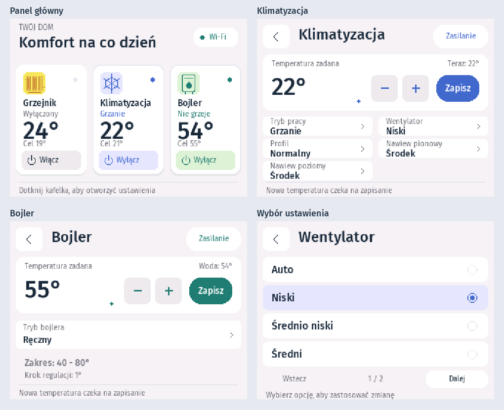

# CYD HA Control

Dotykowy panel sterowania Home Assistant dla płytki **ESP32-2432S028R (CYD)** z ekranem 2,8″. Zapewnia dostęp do grzejnika, klimatyzacji i bojlera w poziomym interfejsie 320 × 240 px.



Jasny interfejs z czcionką Fira Sans, polskimi znakami i osobnymi kafelkami urządzeń. Podgląd przedstawia przykładowe dane.

## Funkcje

| Urządzenie | Dostępne funkcje |
| --- | --- |
| Grzejnik | Zasilanie, tryb pracy, podgląd temperatury i zmiana nastawy |
| Klimatyzacja | Zasilanie, temperatura, tryby pracy, wentylator, presety i kierunek nawiewu |
| Bojler | Zasilanie, informacja o grzaniu, temperatura aktualna i zadana, wybór trybu pracy |

Opcje, zakresy temperatur i krok regulacji są odczytywane z Home Assistant. Dostępność funkcji zależy od urządzenia i jego integracji.

Panel automatycznie odświeża stany, ponawia połączenie Wi-Fi i aktualizuje tylko zmienione fragmenty obrazu. Przy braku aktualnych danych blokuje sterowanie.

## Wymagania

- Płytka ESP32-2432S028R z wyświetlaczem **ILI9341** i dotykiem **XPT2046**.
- Sieć Wi-Fi 2,4 GHz z dostępem do Home Assistant.
- Home Assistant udostępniający lokalne API przez HTTP.
- Długoterminowy token dostępu Home Assistant.
- PlatformIO oraz przewód USB z transmisją danych.

Konfiguracja wyświetlacza dotyczy wariantu ILI9341. Inne wersje CYD mogą wymagać zmiany sterownika.

## Konfiguracja

1. Przy pierwszym uruchomieniu skopiuj `include/config.example.h` jako `include/config.h`.
2. Uzupełnij dane połączenia:

   | Parametr | Wartość |
   | --- | --- |
   | `WIFI_SSID` | Nazwa sieci Wi-Fi |
   | `WIFI_PASSWORD` | Hasło sieci Wi-Fi |
   | `HA_URL` | Adres serwera, np. `http://192.168.1.100:8123`, bez końcowego `/` |
   | `HA_TOKEN` | Długoterminowy token wygenerowany w profilu użytkownika HA |

3. W tablicy `DEVICES` przypisz encje grzejnika, klimatyzacji i zasilania bojlera. Przykładowa konfiguracja wykorzystuje odpowiednio domeny `climate`, `climate` i `switch`.
4. Uzupełnij dodatkowe encje bojlera:

   | Parametr | Przeznaczenie |
   | --- | --- |
   | `BOILER_CONTROL_ENTITY` | Encja `water_heater` do podglądu i zmiany ustawień |
   | `BOILER_HEATING_ENTITY` | Encja `binary_sensor` sygnalizująca grzanie |
   | `BOILER_TARGET_ENTITY` | Encja `sensor` z odczytem temperatury zadanej |

Identyfikatory encji znajdziesz w **Narzędziach deweloperskich → Stany** w Home Assistant. Nazwy w pliku przykładowym należy zastąpić własnymi.

`include/config.h` zawiera prywatne dane i jest pomijany przez Git. Hasło i token trafiają również do skompilowanego firmware — przechowuj te pliki bezpiecznie.

## Uruchomienie

Otwórz projekt w PlatformIO, podłącz płytkę przez USB i wybierz **Build**, a następnie **Upload**. Biblioteki zostaną pobrane automatycznie.

Z terminala:

```sh
pio run
pio run --target upload
```

Diagnostyka połączenia i urządzeń jest dostępna w monitorze szeregowym:

```sh
pio device monitor --baud 115200
```

## Obsługa

- **Górna część kafelka** otwiera ustawienia urządzenia.
- **Dolny przycisk kafelka** włącza lub wyłącza urządzenie.
- **− / +** zmienia temperaturę do zapisania. Przycisk **Zapisz** wysyła nową nastawę.
- **Wybór opcji z listy** od razu stosuje tryb, preset lub ustawienie wentylatora i nawiewu.
- **Strzałka w lewym górnym rogu** zamyka listę lub wraca do ekranu głównego. Powrót do ekranu głównego porzuca niezapisaną temperaturę.

Duża liczba na kafelku przedstawia **temperaturę aktualną**, a opis **Cel** poniżej wskazuje temperaturę zadaną. Szczegóły urządzenia zawierają regulację nastawy i dostępne opcje.

Po wysłaniu polecenia panel ponownie odczytuje stan z Home Assistant. Aktualizacja może pojawić się z opóźnieniem zależnym od integracji urządzenia. Panel nie włącza urządzeń samodzielnie po uruchomieniu.

## Ekran i dotyk

Orientację ustawisz przez `PanelUI::ROTATION` w `include/panel_ui.h`: `1` oznacza widok poziomy, a `3` widok poziomy obrócony o 180°.

Jeśli dotyk nie pokrywa się z przyciskami, włącz `TOUCH_DEBUG` w konfiguracji i sprawdź współrzędne w monitorze szeregowym. Dostosuj `TOUCH_X_MIN/MAX` oraz `TOUCH_Y_MIN/MAX`; odwrócenie zakresu odwraca daną oś. Po zmianach wgraj firmware ponownie.
